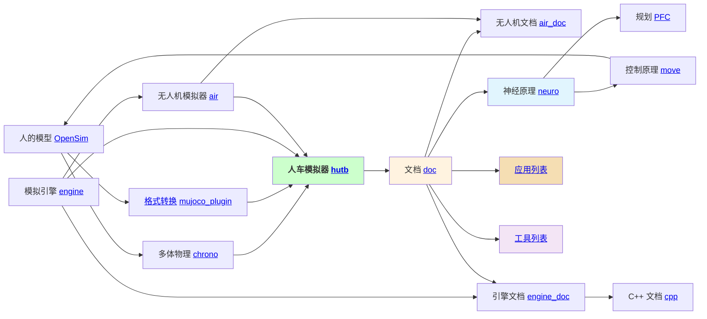
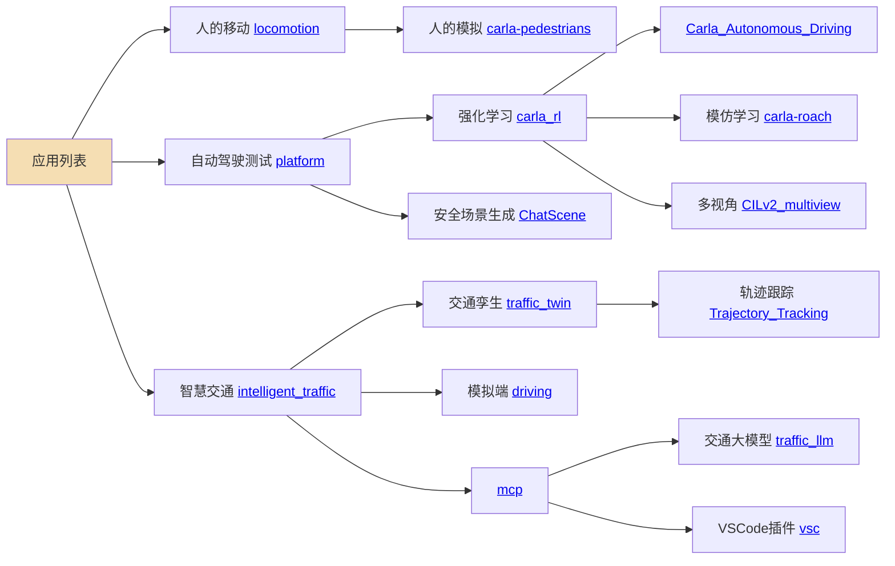
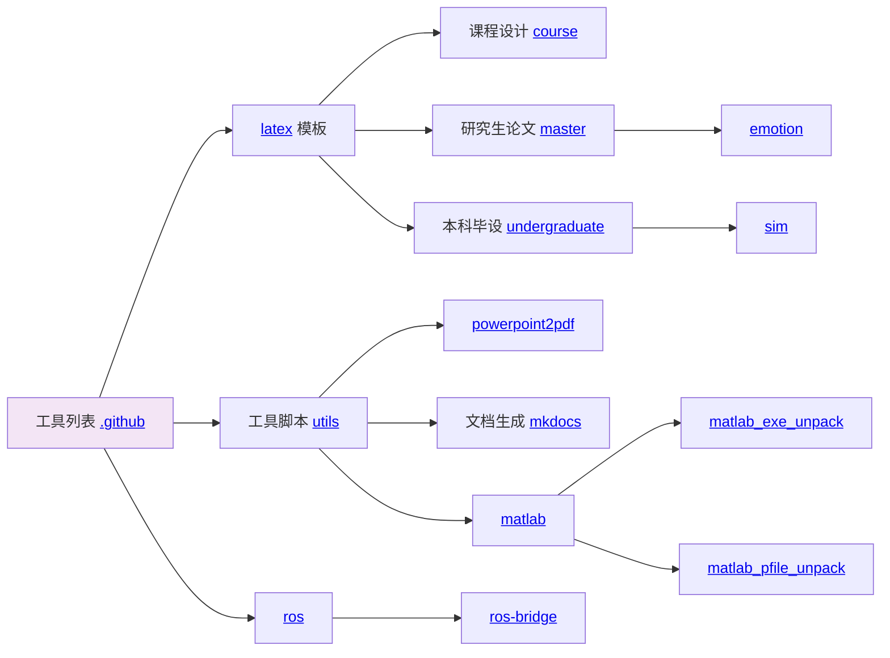

# OpenHUTB

该社区提供一个包含人车代理（学术研究）、模拟器（技术开发包括数据驱动、机理仿真、界面渲染）、现实场景（艺术增强）的 [模拟器](https://openhutb.github.io) ，代理包括[感知](https://openhutb.github.io/doc/algorithms/perception/) （连接）、[规划](https://openhutb.github.io/doc/algorithms/planning/) （符号）、[控制](https://openhutb.github.io/doc/algorithms/control/) （行为）；模拟器包括Python与C++的接口（正向创建、反向构建）、LibCarla、虚幻引擎插件；现实场景包括 [静态场景孪生](https://openhutb.github.io/doc/adv_digital_twin/) 、[动态场景孪生](https://github.com/OpenHUTB/traffic_twin/) 。
人车模拟器的技术架构入下图所示：

<!--所有项目关系的思维导图。-->
<!-- 使用markmap进行编辑并生成svg：https://markmap.js.org/repl -->
<!-- 在profile/markmap.md中保存图的数据 -->
<!-- svg图片预览：https://raw.githack.com/ -->

## 社区项目之间的关系

### 应用列表

### 工具列表

## 我的开源参与计划

我想先把社区里几篇经常会用到的说明读明白，再找出照着操作时容易卡住的地方。当前更适合从文档入手：一次处理一个具体问题，把出现位置、修改理由和检查结果说清楚。

### 先把入口走通

链接写得像是正确的，不代表点开后就能到达目标。阅读发布指南时，我会核对邮箱显示文字和实际收件地址是否一致；遇到软件下载链接，也会确认页面对应的产品。对于失效或指向错误的入口，先记录问题，再单独提交修正。

### 再把排查顺序理清

环境配置出问题时，直接给出一个大范围的操作，往往看不出原因。我会先区分本机能否访问、端口是否发布、其他设备能否连接，再整理成简短步骤。修改说明时写清楚命令在哪里运行、结果应该看什么，涉及网络规则时只调整需要的端口。

### 遇到概念问题，查清再改

参考文献条目的 key 需要唯一，与同一篇文献能否多次引用，是两个不同的问题。这类表述我会结合示例和原始说明核对，避免把有条件的处理方法写成通用结论。修改后同时检查正文、示例和总结，防止前后说法不一致。

每次提交前，我会查看最终差异，确认没有混入其他页面的修改，并打开文档网页核对链接、代码和列表。参与审核时也会实际查看改动指向的内容；发现问题就说明位置和原因，能确认通过的再给出通过意见。后续会继续跟进讨论，把收到的建议补进对应修改。

本轮记录：

- 邮箱入口：[问题 #251](https://github.com/OpenHUTB/.github/issues/251)、[修改 #250](https://github.com/OpenHUTB/.github/pull/250)。
- GitLab 访问排查：[问题 #252](https://github.com/OpenHUTB/.github/issues/252)、[修改 #253](https://github.com/OpenHUTB/.github/pull/253)。
- 参考文献说明：[问题 #254](https://github.com/OpenHUTB/.github/issues/254)、[修改 #255](https://github.com/OpenHUTB/.github/pull/255)。

